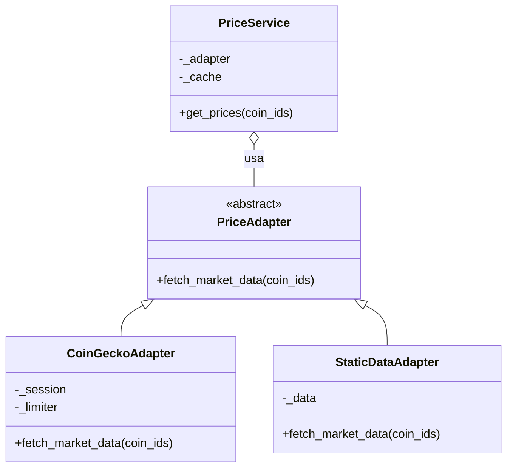

# Analisador de Carteira e Estratégias de Cripto

Projeto em **Python** que modela uma carteira de criptoativos, regras de negociação,
avaliação de risco, estratégias de investimento e backtests. A integração externa é
feita com a API pública da **CoinGecko**.

A demonstração principal foi organizada por requisito funcional (**RF1 → RF10**),
facilitando tanto a apresentação no terminal quanto a apresentação do código.

## Como executar

Instale as dependências:

```bash
python -m pip install -r requirements.txt
```

Execute a demonstração:

```bash
python main.py
```

Execute os testes automatizados:

```bash
python -m pytest -q
```

Atualmente, a suíte possui **9 testes automatizados**.

> A maior parte das demonstrações usa dados controlados para não depender da rede.
> A demonstração do **RF8** usa a CoinGecko ao vivo e, portanto, precisa de internet.

---

## Menu de demonstração

Ao executar `python main.py`, o programa apresenta os requisitos na mesma ordem da
especificação:

```text
1.  RF1  — Carteira protegida
2.  RF2  — Sem mistura implícita de moedas
3.  RF3  — Histórico reprodutível
4.  RF4  — Tipos de criptoativos
5.  RF5  — Modelos de risco plugáveis
6.  RF6  — Erros de negociação distinguíveis
7.  RF7  — Trilha de auditoria imutável
8.  RF8  — Preços cientes de limite de requisições
9.  RF9  — Conjunto aberto de estratégias
10. RF10 — Torneio de estratégias
0.  Sair
```

Cada opção mostra também o arquivo/classe principal responsável pela implementação
do requisito, servindo como guia para a apresentação do código.

---

## Estrutura do projeto

```text
crypto_portfolio/
├── money.py              # RF2 — Amount e proteção contra mistura implícita de moedas
├── errors.py             # RF6 — exceções específicas para falhas de negociação
├── assets.py             # RF4 — Asset abstrata + Coin / Stablecoin / Token
├── audit.py              # RF7 — Trade imutável + AuditTrail
├── portfolio.py          # RF1 — Portfolio protegido e execute_trade() + Prototype
├── portfolio_builder.py  # Builder — PortfolioBuilder (padrão criacional)
├── risk_models.py        # RF5 — modelos de risco plugáveis
├── market_data.py        # RF3 — histórico imutável | RF8 — API, cache, rate limit e retry + Adapter (padrão estrutural)
├── strategies.py         # RF9 — Strategy + registro aberto + Decorator (padrão estrutural)
└── tournament.py         # RF10 — execução e ranking das estratégias

main.py                              # demonstração RF1 → RF10
tests/test_offline.py                # testes automatizados sem dependência de rede
tests/test_prototype.py              # testes do padrão Prototype
tests/test_prototype_and_builder.py  # testes do padrão Builder
tests/test_decorator.py              # testes do padrão Decorator
tests/test_adapter.py                # testes do padrão Adapter
index.html                           # diagrama do projeto
requirements.txt                     # dependências
```

---

# Requisitos funcionais

## RF1 — Carteira protegida

**Código principal:** `crypto_portfolio/portfolio.py`

A classe `Portfolio` mantém caixa e posições protegidos. O estado da carteira muda
somente por operações controladas em `execute_trade()`.

Antes de modificar qualquer valor, a operação é validada. Se ocorrer uma falha,
a carteira permanece intacta.

Exemplo demonstrado:

- compra válida de BTC;
- tentativa de vender mais BTC do que existe na carteira;
- operação recusada;
- saldo e posições permanecem inalterados após a falha.

---

## RF2 — Sem mistura implícita de moedas

**Código principal:** `crypto_portfolio/money.py`

Valores monetários são representados por `Amount`.

Uma soma como:

```text
100 BRL + 20 USD
```

é rejeitada com `CurrencyMismatchError`.

A combinação só é permitida após uma conversão explícita:

```text
20 USD → BRL
100 BRL + valor convertido
```

Assim, o próprio projeto impede a mistura acidental de moedas diferentes.

---

## RF3 — Histórico reprodutível

**Código principal:** `crypto_portfolio/market_data.py`

`PricePoint` é imutável e `HistoricalSeries` armazena seus pontos em uma estrutura
que não pode ser alterada externamente.

A demonstração comprova que:

- um preço histórico não pode ser editado;
- não é possível adicionar pontos diretamente ao histórico obtido;
- executar o mesmo backtest duas vezes com o mesmo histórico e capital produz o
  mesmo resultado.

---

## RF4 — Tipos de criptoativos

**Código principal:** `crypto_portfolio/assets.py`

`Asset` é uma classe abstrata.

Os tipos:

- `Coin`
- `Stablecoin`
- `Token`

herdam de `Asset` e implementam seu próprio comportamento de risco.

Exemplos:

- `Coin`: considera volatilidade;
- `Stablecoin`: considera o desvio da paridade de USD 1;
- `Token`: combina volatilidade e penalidade de liquidez/ranking.

Todos respondem ao mesmo método `risk_score()`, demonstrando herança e polimorfismo.

---

## RF5 — Modelos de risco plugáveis

**Código principal:** `crypto_portfolio/risk_models.py`

A abstração `RiskModel` permite avaliar a mesma carteira usando modelos diferentes.

Modelos disponíveis:

- `ConservativeRiskModel`
- `AggressiveRiskModel`

O modelo é selecionado em tempo de execução por `get_risk_model()` sem modificar a
estrutura da carteira.

---

## RF6 — Erros de negociação distinguíveis

**Código principal:** `crypto_portfolio/errors.py` e `crypto_portfolio/portfolio.py`

As falhas possuem exceções específicas, entre elas:

- `AssetNotFoundError`
- `InsufficientBalanceError`
- `InsufficientPositionError`
- `InvalidQuantityError`
- `InvalidPriceError`
- `InvalidExchangeRateError`
- `RateLimitExceededError`

Isso permite distinguir situações diferentes, em vez de tratar qualquer falha como
um erro genérico.

---

## RF7 — Trilha de auditoria imutável

**Código principal:** `crypto_portfolio/audit.py`

Cada negociação concluída gera um `Trade`.

`Trade` é definido como imutável (`frozen=True`) e o `AuditTrail` expõe as
negociações apenas para leitura.

A demonstração realiza operações `BUY` e `SELL`, mantém ambas no histórico e comprova
que uma transação antiga não pode ser alterada.

Também não existem operações públicas de `remove`, `edit` ou `clear` no histórico.

### Observação

A trilha de auditoria é preservada durante a execução do programa. O projeto atual
não utiliza banco de dados ou arquivo persistente; portanto, ao encerrar e iniciar
uma nova execução, um novo estado em memória é criado.

---

## RF8 — Preços cientes de limite de requisições

**Código principal:** `crypto_portfolio/market_data.py`

Este é o requisito que demonstra diretamente a integração com a **CoinGecko**.

O `PriceService`, em conjunto com o `CoinGeckoAdapter` que busca os preços:

- busca preços atuais;
- consulta BTC, ETH e USDT em lote;
- mantém cache com TTL;
- evita chamadas externas redundantes;
- usa `TokenBucketRateLimiter`;
- trata HTTP 429;
- respeita `Retry-After` quando fornecido;
- aplica backoff antes de novas tentativas.

O cache, a deduplicação e o TTL ficam no `PriceService`. O limitador, o tratamento de
HTTP 429, o `Retry-After` e o backoff ficam no `CoinGeckoAdapter` (ver Adapter em
[Padrões de Projeto](#padrões-de-projeto)).

Na demonstração, duas consultas iguais feitas em sequência reutilizam os dados em
cache.

---

# Uso da CoinGecko

A integração externa fica encapsulada em `crypto_portfolio/market_data.py`: os preços atuais
passam pelo `CoinGeckoAdapter` e o histórico, pelo `HistoricalDataStore`.

Os principais recursos utilizados são:

### Preços atuais

```text
/coins/markets
/simple/price
```

São usados para obter dados como:

- preço em USD;
- preço em BRL;
- variação de 24 horas;
- posição no ranking de capitalização.

### Histórico

```text
/coins/{coin_id}/market_chart
```

É usado pelo `HistoricalDataStore` para obtenção de séries históricas.

No `main.py` atual, dados controlados são usados em vários RFs para tornar as
demonstrações independentes de conexão e de variações externas. A CoinGecko real é
demonstrada diretamente no RF8.

---

## RF9 — Conjunto aberto de estratégias

**Código principal:** `crypto_portfolio/strategies.py`

A classe abstrata `Strategy` define o contrato comum das estratégias.

As implementações são registradas por `@register_strategy`.

Estratégias atuais:

- HODL
- DCA
- Rebalanceamento
- Stop-Loss

`available_strategies()` descobre as estratégias registradas sem exigir uma lista
fixa em outros módulos.

Assim, uma nova estratégia pode ser adicionada sem modificar as implementações
existentes.

---

## RF10 — Torneio de estratégias

**Código principal:** `crypto_portfolio/tournament.py`

`Tournament.run()` obtém as estratégias registradas por `available_strategies()` e
executa todas contra:

- o mesmo histórico;
- o mesmo capital inicial;
- as mesmas condições de simulação.

No final, os resultados são ordenados por retorno.

O torneio não conhece antecipadamente os nomes ou a quantidade de estratégias.
Portanto, uma nova estratégia registrada no RF9 passa automaticamente a participar
do RF10.

---
# Padrões de Projeto

## Padrões Criacionais

### Prototype

A carteira e compra inicial eram sempre refeitas para cada estratégia, apenas para que todas pudessem partir do mesmo princípio no torneio de estratégias (RF10), mas que é feito por convenção, e não por construção. O prototype é aplicado para que várias instâncias idênticas sejam clonadas para garantir as mesma execuções automaticamente.
* Aplicando em Tournament.run(), onde a carteira é montada uma vez com carteira_incial e cada estratégia é copiada com carteira_inicial_clonar().
* Com isso, a única forma de alterar um clone é por execute_trade() do mesmo.
A solução aplicada anteriormente não funciona completamente, pois a cópia permite alterações nos dados originais de forma incoerente.

### Builder

A carteira inicial do torneiro é montada em várias etapas e, quando finalizada, validada em outro lugar. O Builder é aplicado para reunir essas etapas em chamadas nomeadas, além de validá-las antes de formar a carteira final.
Foi aplicada usando uma classe portfólio PortifolioBulder, com os métodos:
* .com_moeda_base: Define qual a moeda base da carteira (é mantido durante todas as operações)
* .com_caixa_inicial: Define o valor inicial da carteira (na moeda base).
* .com_precos: Define Os preços de cada ativo na moeda base.
* .com_posicao_por_peso: Quanto cada caixa inicial vale para o ativo (intervalo [0,1]).
* .com_posicao: Define uma compra de quantidade fixa, aplicada pelo usário.
* .build: Valida os métodos anteriores, cria o objeto Portifolio e realiza as operações da carteira.
Assim, nenhuma informação é inserida diretamente e sim por execute_trade(), portanto as funcionalidades aplicadas antes ainda são válidas para as carteiras formadas.

## Padrões Estruturais

### Decorator

**Código principal:** `crypto_portfolio/strategies.py`

As estratégias (HODL, DCA, Rebalanceamento, Stop-Loss) devolvem recomendações puras. Em cenários reais, é necessário adicionar comportamentos transversais — como logging de decisões ou limites de risco — sem modificar o código de cada estratégia individualmente.

O Decorator envolve uma estratégia existente e adiciona comportamento antes ou depois do `evaluate()`, preservando a interface `Strategy`. Decorators podem ser empilhados livremente.

Foram implementadas três classes:

* `StrategyDecorator(Strategy)`: classe base abstrata que recebe uma estratégia (`_wrapped`) e delega `name` e `evaluate()` a ela por padrão. Como herda de `Strategy`, qualquer decorator é intercambiável com uma estratégia comum — inclusive no torneio (RF10).
* `LoggingDecorator(StrategyDecorator)`: registra internamente cada recomendação emitida pela estratégia envolvida. Oferece acesso somente-leitura ao log via tupla imutável e método `limpar_log()` para reiniciar.
* `RiskLimitDecorator(StrategyDecorator)`: filtra recomendações de compra cujo `risk_score()` do ativo exceda um limiar configurável (`max_risk`). Compras bloqueadas são convertidas em HOLD com justificativa. Vendas e holds passam inalterados.

Exemplo de uso:

```python
# Estratégia pura
strategy = DcaStrategy()

# Com logging
strategy = LoggingDecorator(DcaStrategy())

# Empilhado: logging + limite de risco
strategy = LoggingDecorator(
    RiskLimitDecorator(DcaStrategy(), max_risk=Decimal("30"))
)
```

Os decorators não são registrados com `@register_strategy` — são wrappers opcionais, não estratégias independentes.

### Adapter

**Código principal:** `crypto_portfolio/market_data.py`

**Problema.** O `PriceService` fazia dois trabalhos ao mesmo tempo: guardar preços em cache e deduplicar pedidos (RF8) e conversar com a CoinGecko. Tudo o que é específico dessa API estava dentro dele: os endpoints (`/coins/markets` e `/simple/price`), os nomes dos campos do JSON (`current_price`, `price_change_percentage_24h`, `market_cap_rank`), o limite de requisições e o retry em HTTP 429. Isso causava dois problemas concretos:

1. **O RF8 só podia ser verificado com internet.** O cache e a deduplicação ("3 estratégias, 1 chamada") dependiam da CoinGecko ao vivo, e nenhum teste usava o `PriceService`.
2. **Trocar a fonte de preços exigiria reescrever o serviço** ou enchê-lo de `if/else`, misturando duas APIs na mesma classe.

**Por que Adapter.** A CoinGecko é uma API de terceiros: não controlamos o formato do JSON, os limites nem as mudanças. O Adapter existe para esse caso: traduzir uma interface que não controlamos na interface que o nosso código espera. O `PriceService` passa a depender só de um contrato pequeno (`PriceAdapter.fetch_market_data`), e toda a tradução da CoinGecko fica em uma classe. Outros padrões do projeto não resolveriam isto: o Decorator mantém a interface e acrescenta comportamento, e aqui é preciso **traduzir** uma interface.

**Como foi aplicado.**

* `PriceAdapter` (Target): interface abstrata com `fetch_market_data(coin_ids)`. Devolve `{id: MarketPoint}` só para os ids que a fonte conhece e deixa as falhas de rede subirem como exceção.
* `CoinGeckoAdapter` (Adapter): contém o código que já existia, movido sem mudar o comportamento: endpoints, tradução do JSON para `MarketPoint`, `TokenBucketRateLimiter` e retry em HTTP 429 (`Retry-After` e backoff). O limitador fica aqui, e não no `PriceService`, porque cada busca faz **duas** requisições (USD e BRL) e ele é consultado a cada uma. Se ficasse no serviço, contaria uma por busca e o RF8 seria violado.
* `StaticDataAdapter`: preços fixos em memória, sem rede, para testes e demonstrações offline.
* `PriceService`: mantém o cache com TTL, a deduplicação e o `Lock` (o que não depende da fonte) e recebe o adaptador por injeção. Sem `adapter`, usa um `CoinGeckoAdapter`, então `PriceService(cache_ttl=30.0, max_calls_per_minute=10)` continua valendo. Passar `session` e `adapter` juntos é recusado, porque a sessão HTTP pertence ao adaptador.



Exemplo de uso:

```python
# Produção: a CoinGecko
servico = PriceService(cache_ttl=30.0, adapter=CoinGeckoAdapter(max_calls_per_minute=10))

# Testes e demonstrações offline: dados controlados, sem rede
servico = PriceService(adapter=StaticDataAdapter({"bitcoin": ponto_btc}))
```

**Conversões com perda.** O `CoinGeckoAdapter` converte preço ou variação ausentes em 0, `market_cap_rank` ausente em 9999 e preço em BRL ausente em 0. Essas decisões já existiam de forma implícita no código; agora estão documentadas na classe e cobertas por teste.

**Trade-offs e alternativas.**

* **Custo:** três classes novas para uma única fonte real. Hoje o ganho imediato é isolar a CoinGecko e testar o RF8 offline. Trocar de provedor (por exemplo, a CoinMarketCap) passa a ser possível, mas essa integração não foi implementada.
* **Solução mais simples:** injetar uma função `buscar(coin_ids) -> dict` no lugar de uma hierarquia de classes. Funcionaria em Python, mas o adaptador guarda estado (sessão e limitador) e o contrato fica explícito e documentado na interface, por isso foi escolhida a classe.
* **Padrões parecidos descartados:** Facade, que cria uma interface nova e mais simples para vários subsistemas (aqui o problema é uma interface incompatível, não a complexidade de um subsistema); e Proxy, que mantém a interface e controla o acesso (o cache já existe no `PriceService`, e o Proxy não traduz formatos).

**Onde não foi aplicado.** O `HistoricalDataStore` continua acoplado ao endpoint `market_chart` da CoinGecko. Ele tem o mesmo sinal de alerta, mas exigiria outro contrato (histórico por período) e ficou fora deste trabalho. `Strategy` e `RiskModel` também não precisam de Adapter: são interfaces do próprio projeto, que podemos ajustar diretamente.

**Verificação.**

* `python -m pytest -q` passa com 65 testes: os 47 anteriores e 18 novos em `tests/test_adapter.py`.
* O `PriceService` anterior (commit `9a5ea50`) e o atual foram comparados em 14 cenários com uma sessão HTTP falsa (cache, TTL, HTTP 429 com e sem `Retry-After`, erros HTTP e de rede, valores nulos). As requisições, as esperas, os resultados e as exceções foram idênticos.
* A saída do menu offline é idêntica à anterior (328 linhas). Na demonstração do RF8, com a rede simulada, muda apenas a linha que indica o código principal.
* Nada disso foi executado contra a CoinGecko real; a demonstração ao vivo do RF8 continua dependendo de internet.

---

# Testes

Os testes ficam em:

```text
tests/test_offline.py                # regras de negócio (RF1-RF7, RF9, RF10)
tests/test_prototype.py              # padrão Prototype (Portfolio.clonar)
tests/test_prototype_and_builder.py   # padrão Builder (PortfolioBuilder)
tests/test_decorator.py              # padrão Decorator (LoggingDecorator, RiskLimitDecorator)
tests/test_adapter.py                # padrão Adapter (PriceService, CoinGeckoAdapter, StaticDataAdapter)
```

Eles foram construídos para validar as regras de negócio sem depender da internet.

Execute:

```bash
python -m pytest -q
```

Resultado esperado na versão atual:

```text
65 passed
```

A demonstração ao vivo do RF8 depende da CoinGecko e é executada pelo `main.py`.

---

# Mapa rápido para apresentação do código

| RF | Arquivo principal | Conceito central |
|---|---|---|
| RF1 | `portfolio.py` | encapsulamento e validação antes da mutação |
| RF2 | `money.py` | tipo monetário seguro e conversão explícita |
| RF3 | `market_data.py` | imutabilidade do histórico |
| RF4 | `assets.py` | abstração, herança e polimorfismo |
| RF5 | `risk_models.py` | estratégia/modelo plugável |
| RF6 | `errors.py` / `portfolio.py` | exceções específicas |
| RF7 | `audit.py` | registro imutável de negociações |
| RF8 | `market_data.py` | CoinGecko (via `CoinGeckoAdapter`), cache, rate limit e retry |
| RF9 | `strategies.py` | registro aberto de estratégias |
| RF10 | `tournament.py` | execução uniforme e ranking |

---

# Limitações conhecidas

- A CoinGecko pública possui limites de requisição. O projeto reduz esse problema
  com cache, rate limiter e retry, mas a disponibilidade final ainda depende do
  serviço externo.
- A trilha de auditoria é imutável durante a execução, mas ainda não é persistida em
  banco de dados ou arquivo entre execuções.
- O backtest é uma simulação educacional e não considera todas as condições de uma
  corretora real, como taxas, slippage e latência.
